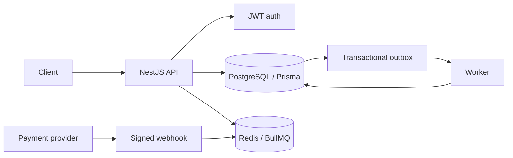
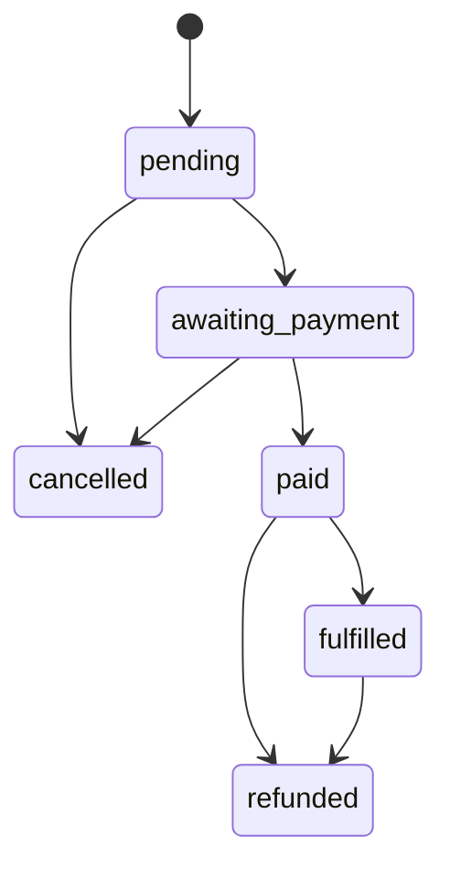

# Checkout Service

An open-source orders and payments microservice for teams that need reliable checkout semantics without coupling inventory, persistence, and payment-provider behavior.

Repository: [github.com/JEHH97/checkout-service](https://github.com/JEHH97/checkout-service)

**Problem.** A payment callback can be delivered more than once, orders can be submitted on network retries, and simultaneous buyers can compete for the last unit. This project makes these failure modes explicit and observable.

**Demo:** [Live API placeholder](https://example.com/demo)

## Architecture





## Stack

- NestJS, TypeScript strict mode, Swagger/OpenAPI (`/docs`), Pino structured logs, Terminus health endpoints.
- PostgreSQL with Prisma, Redis with BullMQ, Stripe PaymentIntents behind a `PaymentGateway` interface.
- Jest, Supertest, ESLint, Prettier, Docker Compose, GitHub Actions.

## Technical decisions

- **Idempotency:** `Idempotency-Key` records persist a canonical request fingerprint and response. Identical retries replay; changed payloads conflict.
- **Outbox:** order state and an event record commit in the same PostgreSQL transaction. A relay publishes committed rows asynchronously, avoiding a database/broker dual-write gap.
- **Inventory concurrency:** checkout reserves availability inside a serializable transaction with a version-checked conditional update; concurrent attempts cannot drive stock negative. Reservations are reflected when the order is created.
- **Webhook safety:** signature verification precedes persistence; event IDs are unique, and accepted events are queued for retryable processing.
- **Payments:** select `PAYMENT_ADAPTER=fake` locally or `stripe` for Stripe test mode. Tests use the fake adapter only.

## Run locally

Requirements: Docker Compose and Node.js 24+. One command starts API, worker, PostgreSQL, and Redis:

```sh
cp .env.example .env
docker compose up --build
```

Open `http://localhost:3001/docs`; liveness is at `/health/live`. In a second terminal, install dependencies and initialize demo data:

```sh
npm ci
npm run prisma:generate
npm run seed
```

Demo admin: `admin@example.test` / `DemoAdmin2026!` (local showcase only; rotate before use). The seed creates three generic products.

## Tests and checks

```sh
npm ci
npm run check
```

`check` runs lint, formatting verification, TypeScript, unit coverage (domain threshold 70%), database/Redis integration smoke checks when those services are configured, the Supertest checkout flow, production build, and the forbidden-content scanner. Tests use a fake payment gateway; no Stripe calls are made. For container-backed integration checks, keep the Compose services running.

HTTP examples are in [`docs/requests.http`](docs/requests.http). Deployment and Stripe test webhook instructions are in [`DEPLOY.md`](DEPLOY.md).

## License

MIT. See [LICENSE](LICENSE).
