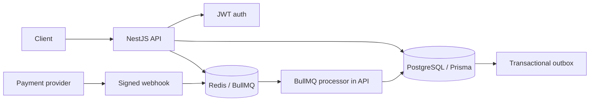
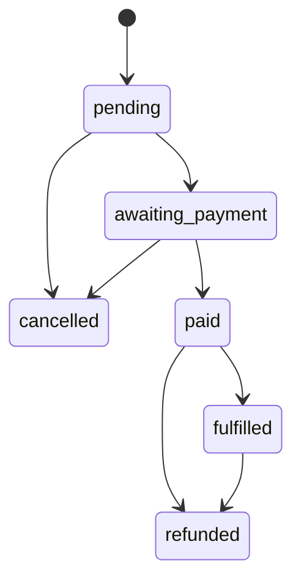

# Checkout Service

An open-source orders and payments microservice for teams that need reliable checkout semantics without coupling inventory, persistence, and payment-provider behavior.

Repository: [github.com/JEHH97/checkout-service](https://github.com/JEHH97/checkout-service)

**Problem.** A payment callback can be delivered more than once, orders can be submitted on network retries, and simultaneous buyers can compete for the last unit. This project makes these failure modes explicit and observable.

**Demo:** _coming soon_

## Architecture





## Stack

- NestJS, TypeScript strict mode, Swagger/OpenAPI (`/docs`), Pino structured logs, Terminus health endpoints.
- PostgreSQL with Prisma, Redis with BullMQ, Stripe PaymentIntents behind a `PaymentGateway` interface.
- Jest, Supertest, ESLint, Prettier, Docker Compose, GitHub Actions.

## Technical decisions

- **Idempotency:** `Idempotency-Key` records persist a canonical request fingerprint and response. Identical retries replay; changed payloads conflict.
- **Outbox:** order state and an event record commit in the same PostgreSQL transaction. A relay publishes committed rows asynchronously, avoiding a database/broker dual-write gap.
- **Inventory concurrency:** checkout reserves availability inside a serializable transaction with a version-checked conditional update; concurrent attempts cannot drive stock negative. Reservations are reflected when the order is created.
- **Webhook safety:** signature verification precedes persistence; event IDs are unique, and accepted events are queued for retryable processing.
- **Payments:** select `PAYMENT_ADAPTER=fake` locally or `stripe` for Stripe test mode. Tests use the fake adapter only.
- **Access control:** customer order reads, cancellation, and payment initiation are owner-only and return `404` for another customer's order. Refunds are restricted to `admin`; the gated demo-pay route requires authentication and permits only the owner or an admin.
- **Authentication and abuse controls:** JWTs expire after `JWT_EXPIRES_IN` (default `1h`). The global IP limit defaults to 120 requests per minute, with 8 requests per minute on login and registration. Configure these with `THROTTLE_LIMIT`, `THROTTLE_TTL_MS`, and `AUTH_THROTTLE_LIMIT`. Tests use higher limits to avoid shared-IP test interference.
- **Proxy IPs:** `TRUST_PROXY_HOPS` defaults to `1` for the single proxy in front of Render; rate limits use the forwarded client IP. Set it to the actual trusted proxy hop count for other deployments and do not trust untrusted forwarded headers.

## Run locally

Requirements: Docker Compose and Node.js 24+. One command starts the API, PostgreSQL, and Redis. BullMQ jobs are processed by the API process:

```sh
cp .env.example .env
docker compose up --build
```

Open `http://localhost:3001/docs`; liveness is at `/health/live`. In a second terminal, install dependencies and initialize demo data:

```sh
npm ci
npm run prisma:generate
npm run seed
```

The idempotent seed creates the public demo account `admin@example.test` / `DemoAdmin2026!` and three generic products. These public credentials are for the demo only; never reuse them for another service.

## Try the demo in 5 steps

The hosted demo remains **coming soon** until it is deployed. When available, open the API root URL (it redirects to Swagger at `/docs`) and:

1. In `POST /auth/login`, submit `{"email":"admin@example.test","password":"DemoAdmin2026!"}` and copy the returned `accessToken`.
2. Select **Authorize** in Swagger and paste the token. The seeded account is an admin; the credentials are public and demo-only.
3. Use `GET /products` to choose a product. In `POST /cart/items`, add its `productId` and a `quantity` of `1`.
4. Call `POST /orders` with a unique `Idempotency-Key`. Copy the returned order `id`, then call `POST /payments/{orderId}/intents` with another unique `Idempotency-Key`.
5. Call `POST /demo/orders/{orderId}/pay` to simulate payment, then `GET /orders/{orderId}`. The order should show `state: "paid"`.

The fake-payment completion route is enabled only when `DEMO_MODE=true` and `PAYMENT_ADAPTER=fake`; it also requires a bearer token and permits the order owner or an admin. Production deployments must leave `DEMO_MODE` unset or false. The API process itself runs the BullMQ processor, so the demo has no separate worker service.

## Tests and checks

```sh
npm ci
npm run check
```

`check` runs lint, formatting verification, TypeScript, unit coverage (domain threshold 70%), database/Redis integration smoke checks when those services are configured, the Supertest checkout flow, production build, and the forbidden-content scanner. Tests use a fake payment gateway; no Stripe calls are made. For container-backed integration checks, keep the Compose services running.

HTTP examples are in [`docs/requests.http`](docs/requests.http). Free-tier demo deployment instructions are in [`DEPLOY.md`](DEPLOY.md). To use Stripe instead of the demo adapter, configure the Stripe test keys and `PAYMENT_ADAPTER=stripe` in a separate deployment; the demo blueprint does not configure Stripe.

For a self-hosted GHCR image deployment with your own PostgreSQL and Redis, see [`DEPLOY-DOCKER.md`](DEPLOY-DOCKER.md).

## License

MIT. See [LICENSE](LICENSE).
